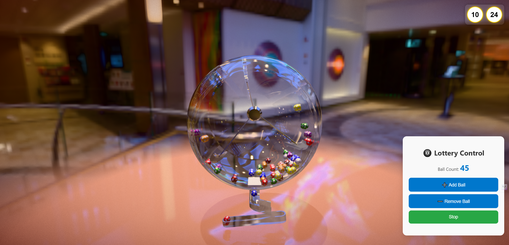
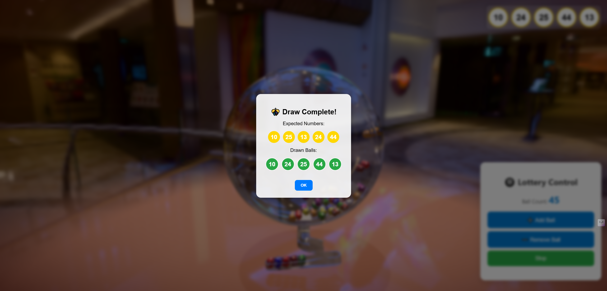

# 3D Lottery Simulation

This project is a 3D lottery simulation built using [Three.js](https://threejs.org/) and a physics engine. It allows users to simulate a lottery draw with interactive controls and a visually appealing 3D environment.

## Features

- **3D Environment**: A realistic 3D lottery machine with balls and animations.
- **Interactive Controls**: Start, stop, and adjust the number of balls in the simulation.
- **Randomized Draw**: Simulates a lottery draw with preselected numbers.
- **Result Display**: Shows the drawn numbers and highlights matches with preselected numbers.
- **Customizable**: Easily modify the number of balls, physics properties, and materials.

## Installation

1. Clone the repository:
   ```bash
   git clone https://github.com/steller102/3d-lottery.git
   cd 3d-lottery
   ```

2. Install dependencies:
   ```bash
   npm install
   ```

3. Start the development server:
   ```bash
   npm start
   ```

4. Open your browser and navigate to `http://localhost:3000`.

## Usage

1. **Start the Lottery**: Click the "🎲 Start Lottery" button to begin the simulation.
2. **Adjust Ball Count**: Use the "+" and "-" buttons to increase or decrease the number of balls (before starting the simulation).
3. **View Results**: After the draw, view the selected and drawn numbers in the result dialog.
4. **Replay**: Press the "SPACE" key or click the "Stop" button to reset and start again.

## File Structure

- **`src/million.js`**: Main logic for the lottery simulation, including physics setup, ball creation, and event handling.
- **`src/index.html`**: HTML structure for the UI.
- **`src/styles.css`**: Styles for the UI and 3D canvas.

## Key Functions

- **`makeMachine()`**: Sets up the 3D lottery machine.
- **`makeBall()`**: Creates and initializes the lottery balls.
- **`startSimulation()`**: Starts the physics simulation.
- **`displaySelectedBall(number)`**: Displays the selected ball in the UI.
- **`showResultDialog(expectedNumbers, drawnBalls)`**: Displays the result dialog with matched numbers.

## Controls

- **Start Button**: Starts or stops the lottery simulation.
- **Increase/Decrease Buttons**: Adjust the number of balls in the simulation.
- **Mouse/Touch**: Interact with the UI elements.

## Dependencies

- [Three.js](https://threejs.org/): For rendering the 3D environment.
- [Physics Engine](https://github.com/lo-th/phy): For simulating realistic physics.

## Customization

You can customize the following aspects of the simulation:

- **Ball Count**: Modify the `ballCount` variable in `million.js`.
- **Materials**: Adjust the materials used for the machine and balls.
- **Physics Properties**: Change friction, restitution, and other physics parameters.

## License

This project is licensed under the MIT License. See the [LICENSE](LICENSE) file for details.

## Acknowledgments

- [Three.js](https://threejs.org/) for the 3D rendering library.
- [Phy.js](https://github.com/lo-th/phy) for the physics engine.
- Inspiration from various 3D lottery simulations online.

## Screenshots


*Example of the 3D lottery machine in action.*


*Result dialog showing matched numbers.*

## Contributing

Contributions are welcome! Feel free to open issues or submit pull requests to improve the project.