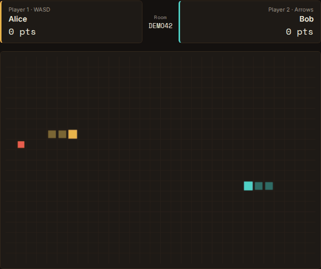
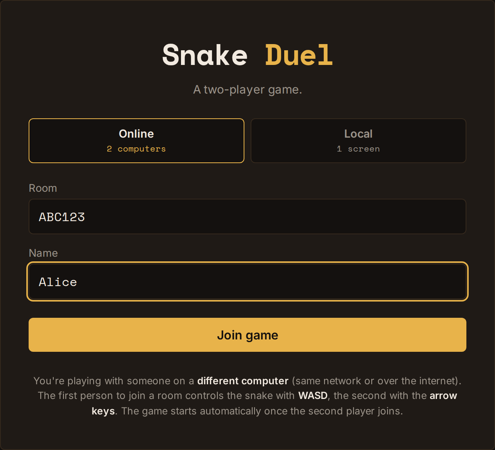

# Snake Duel

A two-player Snake game for the browser. Play on **one keyboard**, or challenge a friend **online over WebSockets** — no accounts, no sign-up, just a room code.


<p align="center">
  
</p>
<p align="center"><sub>A demo round: two browser clients in the same online room.</sub></p>

## Game modes

| Mode | Setup | Controls |
| --- | --- | --- |
| **Local** | One browser window, one keyboard. The game starts instantly after clicking **Start game** — the game engine runs 100% in the browser, with no server involved. | Player 1: **W A S D** · Player 2: **arrow keys** |
| **Online** | Two players on **two separate computers** (same network or over the internet) join the same room code. The game starts automatically as soon as the second player joins. | The first player in the room gets **WASD**, the second gets the **arrow keys** |

> **Note:** in online mode every player needs **their own active browser window** — keyboard input only ever reaches the focused window, which is a browser limitation rather than a limitation of this game. If you want to play on a single computer, use **Local** mode.

<p align="center">
  
</p>

### Rules

- Every piece of food eaten is worth **+10 points** and makes the snake longer.
- The game ends for **both players at once** when a snake hits a wall, runs into its own tail, or collides with the opponent.
- A head-on collision is a **draw**.

## Highlights

- **One engine, two runtimes.** `GameEngine` is a single TypeScript module that is compiled twice: as CommonJS for the Node.js server (online mode) and as native ES modules for the browser (local mode). Both modes run exactly the same game logic.
- **Server-authoritative online play.** Clients only send their intended direction; the server ticks the engine every 150 ms and broadcasts the resulting state, so there is a single source of truth.
- **Room-based matchmaking.** Players are paired by room code, rooms are isolated from each other, a third player gets a "room full" error, and empty rooms are cleaned up automatically.
- **Rematch and disconnect handling.** An online rematch starts once both players agree; if one player drops mid-game, the other one wins.
- **Defensive handling of untrusted input.** Player names are HTML-escaped before being rendered on the client, and the server enforces its own limits on name length, room ID length and WebSocket message size — it doesn't rely on the lobby form's `maxlength`.
- **Bundler-free frontend.** The browser loads the compiled ES modules directly. A tiny post-build script (`scripts/fix-client-esm-extensions.js`) adds the `.js` extensions to relative imports that browsers require.
- **Tested at several levels.** Unit tests for the engine, the same scenarios against the browser build, a regression test for HTML escaping, and an integration test that drives a real server over real WebSocket connections.
- **Docker-ready.** Multi-stage `Dockerfile` and a `docker-compose.yml` for one-command deployment.

## Getting started

Requires Node.js 18+ (tested on Node 22).

```bash
npm install
npm run build   # compiles TypeScript: server -> dist/, client -> public/js/
npm start       # starts on http://localhost:3000
```

Open `http://localhost:3000`. For **local** play a single tab is enough. For **online** play, each player opens the same page on their own computer and enters the same room code.

To use a different port, set the `PORT` environment variable, e.g. `PORT=8080 npm start`.

While developing, re-run `npm run build` after every change in `src/` (or run `npm run build:server` / `npm run build:client` separately).

### Running with Docker

```bash
docker compose up --build
```

The server is exposed at `http://localhost:3000`. Local mode works right away (it doesn't need the server once the page has loaded). Online mode requires the second player to be able to reach the same address (e.g. on the same local network).

## Tests

Build the project first (`npm run build`), then run:

```bash
node test/run-all.js
```

This runs four test suites:

- `test/engine.test.js` — unit tests of the game engine, run against the **server build**: collisions (wall, own tail, opponent — both head-on and into the body), no instant 180° turns, food and scoring.
- `test/client-engine.test.js` — the same collision scenarios, but run against the **browser build** of the engine (`public/js/shared/GameEngine.js`), loaded via a dynamic `import()` exactly as a browser would do it in local mode. This confirms that the ESM-extension fix script (`scripts/fix-client-esm-extensions.js`) works correctly.
- `test/escape-html.test.js` — a regression test for the HTML-escaping helper (`src/client/escapeHtml.ts`) that keeps player names from injecting markup into the game-over screen. It runs against the browser build, like the previous suite.
- `test/integration.test.js` — an integration test of **online mode** over real WebSockets: room matchmaking, role assignment (WASD / arrows), room isolation, rejection of a third player in a full room, a full game up to a wall collision, rematch, disconnect handling, and the server-side input limits (name length, room ID length, oversized messages).

## Project structure

```
src/
  shared/
    protocol.ts          # shared WebSocket message types and game constants
    GameEngine.ts        # movement, collisions, scoring — used by the server
                         # (online mode) and directly in the browser (local mode)
  server/
    index.ts             # bootstrap: Express (static client) + WebSocket
    RoomManager.ts       # rooms by room ID, 2-player matchmaking, rematch
  client/
    main.ts              # both modes: WebSocket (online) and a local engine
                         # loop (local); keyboard handling, canvas rendering
    escapeHtml.ts        # HTML escaping for untrusted text (e.g. player names)
public/
  index.html, style.css  # static frontend (served by Express)
scripts/
  fix-client-esm-extensions.js  # post-build: appends .js to relative imports
                                # in public/js/ (required by browsers, not
                                # needed by tsc itself)
test/
  engine.test.js         # engine unit tests (server build)
  client-engine.test.js  # the same tests against the client build
  escape-html.test.js    # regression test for HTML escaping
  integration.test.js    # tests over real WebSocket connections
  run-all.js             # runs all four suites in sequence
docs/
  demo.gif, lobby.png    # media used in this README
```

## WebSocket protocol (online mode)

Client -> server:

- `{type:"join", roomId, name}`
- `{type:"direction", dir}` — `dir` is `"UP" | "DOWN" | "LEFT" | "RIGHT"`
- `{type:"rematch"}`

Server -> client:

- `{type:"joined", role, controls, roomId}`
- `{type:"waiting_for_opponent"}`
- `{type:"game_start"}`
- `{type:"state", snakes, food, gridWidth, gridHeight}` — about 6–7 times per second (every 150 ms)
- `{type:"game_over", winner, reason, scores}`
- `{type:"error", message}`

Local mode doesn't use WebSockets at all — `src/client/main.ts` creates a `GameEngine` instance directly in the browser and calls `tick()` in a `setInterval` loop every `TICK_MS`.

## Known limitations (intentional, for an MVP)

- An online room holds exactly 2 players; a third player gets a "room full" error.
- An online rematch requires both players to agree (both must click **Rematch**). A local rematch starts immediately — the same pair of players is sitting at one screen, so there is no point in waiting.
- If a player disconnects during an online game, the other player automatically wins.

## License

Released under the [MIT License](LICENSE).
